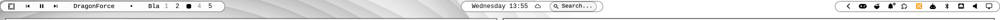

# Plexamp Simple Player

A compact Omarchy bar widget for [Plexamp](https://www.plex.tv/plexamp/): previous, play/pause, next, a looping marquee of the current track, and a star rating.

The controls only appear while Plexamp is running. Track title and artist scroll as a continuous ticker, so long names come back in from the right instead of jumping. Clicking the ticker opens a popup with the album art, full title/artist/album, current rating, and transport controls.



## Requirements

- [Omarchy](https://omarchy.org/) (Quattro / shell plugins)
- Plexamp playing through MPRIS (the desktop app does this by default)
- To set a rating from the bar (optional — everything else works without it):
  a Plex Media Server reachable from this machine, a Plex auth token, and a
  `rate-track.sh`-compatible script at `PLEXAMP_RATER_SCRIPT` (default:
  `~/dev/plexamp-controller/rate-track.sh`). See "Setting a rating" below.

## Install

```bash
omarchy plugin add https://github.com/Inxeo/omarchy-plexamp-simple-player.git --enable
```

The widget defaults to the **center** of the bar. To move it:

```bash
omarchy bar move io.github.inxeo.plexamp-simple-player --section right
```

## Remove

```bash
omarchy plugin remove io.github.inxeo.plexamp-simple-player
```

To disable it but keep the files:

```bash
omarchy plugin disable io.github.inxeo.plexamp-simple-player
```

## How it works

The widget talks to Plexamp over MPRIS (`playerctl`-style desktop media controls). It looks for a player whose D-Bus name, desktop entry, or identity contains `plexamp`, then:

- **Previous / play-pause / next** call that player directly
- **Marquee** shows `Title · Artist` and loops the string when it is wider than the bar slot; clicking it opens a popup with the full track info and controls
- **Tooltip** on hover shows the full `Title — Artist`
- **Rating** reads `xesam:userRating` from the player's MPRIS metadata (0.0–1.0, rounded to the nearest star). Hovering the stars previews a new value; clicking sets it.

### Setting a rating

Plexamp's own MPRIS `Metadata` property is read-only and exposes no method for writing a rating back — this was confirmed by introspecting its D-Bus interface directly, not assumed. The actual rating lives on the Plex Media Server, so setting one from this widget means:

1. `PUT /:/rate` on the Plex server for the track's rating key.
2. Nudging Plexamp's Companion API (`refreshPlayQueue`, or a small seek-forward-then-back) so it re-fetches metadata.

Step 2 is best-effort: Plexamp's own window and its MPRIS export can lag behind the server until the track actually changes — this is a Plexamp limitation, not something the nudge can force. The bar itself always reflects the new rating immediately regardless, since it tracks the value it just set until Plexamp's own metadata catches up.

This widget doesn't implement that flow itself — it shells out to a small external script (`rate-track.sh`) that already does, given `PLEX_SERVER`/`PLEX_TOKEN`. Without that script in place, everything except setting a rating still works normally; clicking a star just does nothing.

## License

MIT. See [LICENSE](LICENSE).
